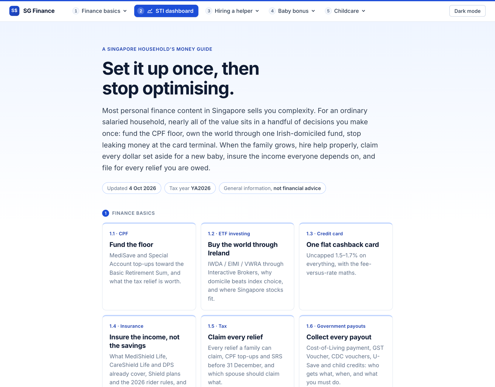
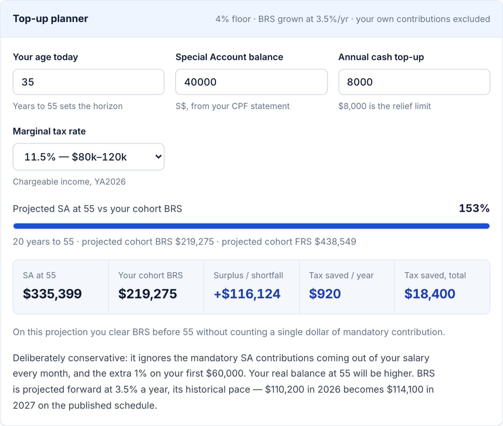
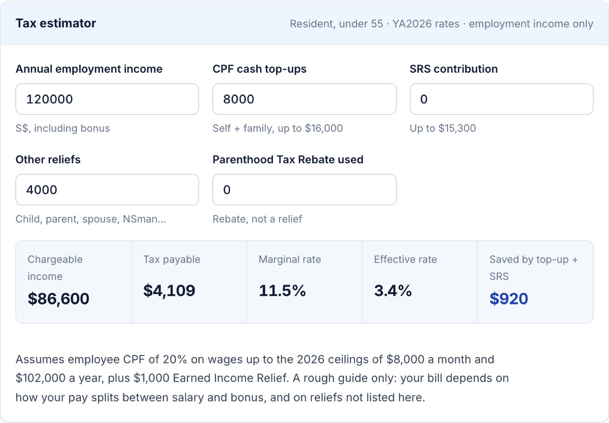
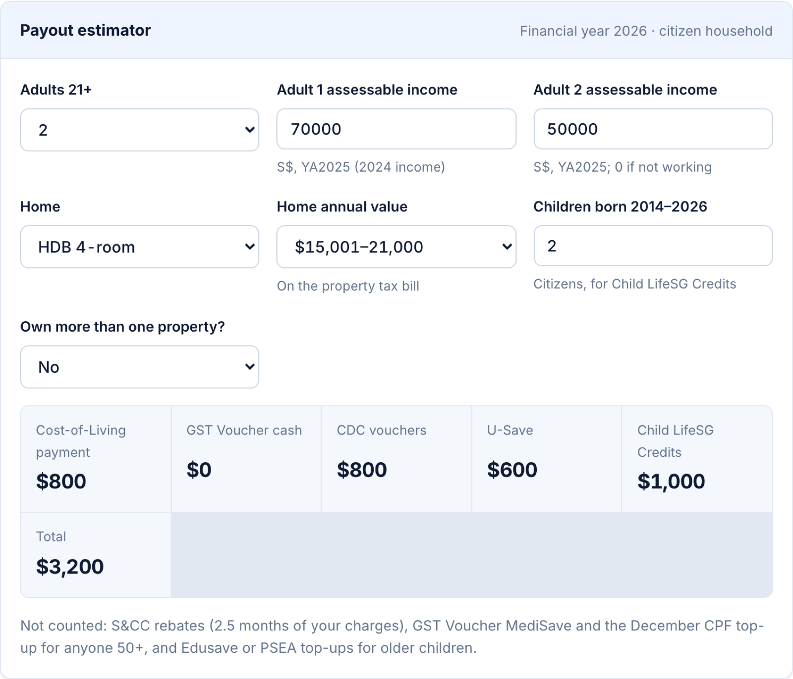
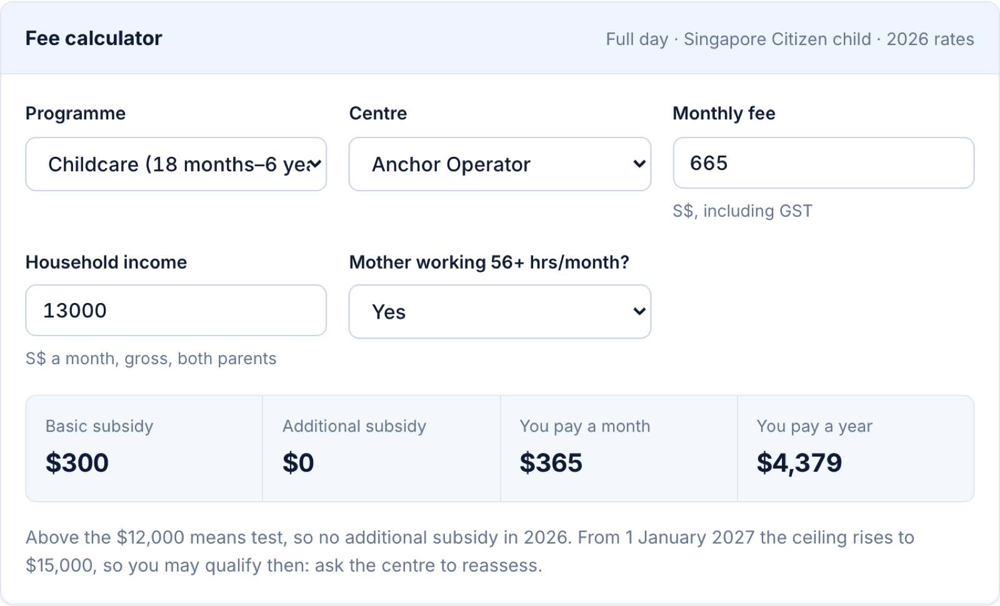
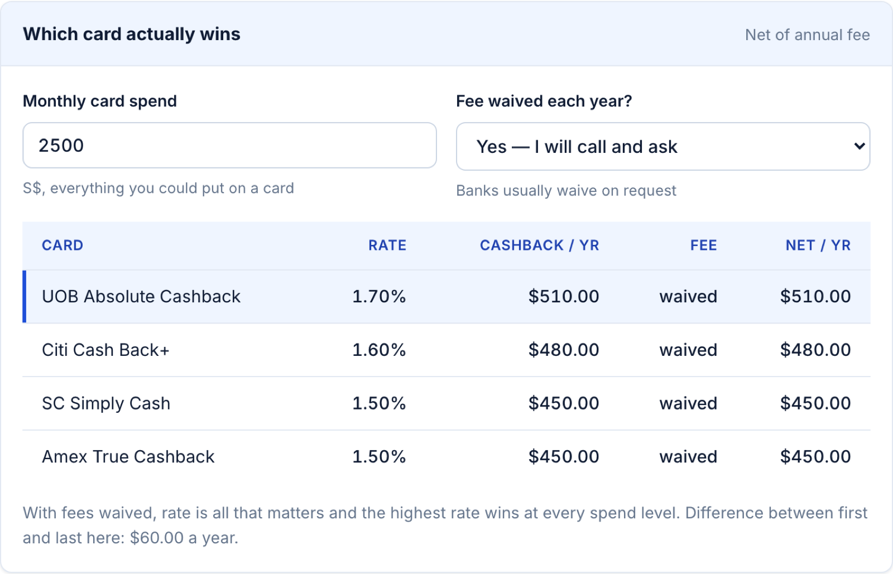
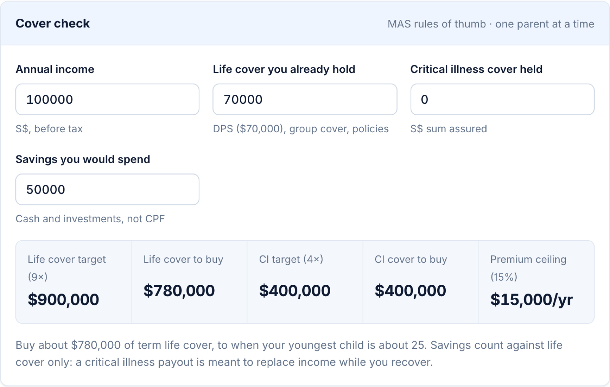

<div align="center">

# 🇸🇬 SG Finance

### Set it up once, then stop optimising.

A free, no-nonsense money guide for Singapore households,<br>
with live calculators for your own numbers.

<br>

[](https://fang89.github.io/Singapore-personal-finance/)

**👉 [fang89.github.io/Singapore-personal-finance/](https://fang89.github.io/Singapore-personal-finance/)**

<br>


<br>

<a href="https://fang89.github.io/Singapore-personal-finance/"><picture><source media="(prefers-color-scheme: dark)" srcset="docs/screenshots/hero-dark.png"></picture></a>

</div>

---

## The idea

Most personal finance content in Singapore sells you complexity. For an ordinary salaried
household, nearly all of the value sits in a handful of decisions you make **once**:

| | Decision | In one line |
|:-:|---|---|
| 🏦 | **Fund the CPF floor** | Top up MediSave and the Special Account toward the Basic Retirement Sum, and bank the tax relief. |
| 🌍 | **Own the world through Ireland** | One Ireland-domiciled accumulating ETF (IWDA / EIMI / VWRA) through Interactive Brokers. |
| 💳 | **One flat cashback card** | Uncapped 1.5–1.7% on everything. No categories, no caps, no tracking. |
| 🛡️ | **Insure the income, not the savings** | Know what MediShield Life, CareShield Life and DPS already cover before buying more. |
| 🧾 | **Claim every relief** | CPF top-ups and SRS before 31 December, and which spouse should claim what. |
| 💸 | **Collect every payout** | Link PayNow, claim the CDC vouchers, and nothing the government sends gets missed. |

When the family grows, the guide covers hiring a helper, every baby benefit, and what
preschool really costs.

The annotated STI chart that used to live here is now its own project:
**[Singapore STI](https://github.com/fang89/Singapore-STI)**.

## 🧮 Six calculators, built in

Type your own numbers; everything updates as you go. Nothing leaves your browser.

<table>
<tr>
<td width="50%" valign="top">

**[CPF top-up planner](https://fang89.github.io/Singapore-personal-finance/#cpf)**<br><sub>Projects your Special Account against your own cohort's Basic Retirement Sum, and the tax you save on the way.</sub>

<picture><source media="(prefers-color-scheme: dark)" srcset="docs/screenshots/calc-cpf-dark.png"></picture>

</td>
<td width="50%" valign="top">

**[Tax estimator](https://fang89.github.io/Singapore-personal-finance/#tax)**<br><sub>YA2026 resident rates, CPF top-ups, SRS and reliefs: your bill, marginal and effective rate.</sub>

<picture><source media="(prefers-color-scheme: dark)" srcset="docs/screenshots/calc-tax-dark.png"></picture>

</td>
</tr>
<tr>
<td width="50%" valign="top">

**[Payout estimator](https://fang89.github.io/Singapore-personal-finance/#payouts-estimator)**<br><sub>Cost-of-Living payment, GST Voucher, CDC vouchers, U-Save and Child LifeSG Credits for your household.</sub>

<picture><source media="(prefers-color-scheme: dark)" srcset="docs/screenshots/calc-payouts-dark.png"></picture>

</td>
<td width="50%" valign="top">

**[Childcare fee calculator](https://fang89.github.io/Singapore-personal-finance/#childcare-fee-calculator)**<br><sub>Basic and additional subsidies against your centre's fee, and what you actually pay.</sub>

<picture><source media="(prefers-color-scheme: dark)" srcset="docs/screenshots/calc-childcare-dark.png"></picture>

</td>
</tr>
<tr>
<td width="50%" valign="top">

**[Cashback card comparison](https://fang89.github.io/Singapore-personal-finance/#cards)**<br><sub>Nets each card's cashback against its annual fee at your monthly spend.</sub>

<picture><source media="(prefers-color-scheme: dark)" srcset="docs/screenshots/calc-card-dark.png"></picture>

</td>
<td width="50%" valign="top">

**[Insurance cover check](https://fang89.github.io/Singapore-personal-finance/#insurance)**<br><sub>Your life and critical illness cover against the MAS rules of thumb.</sub>

<picture><source media="(prefers-color-scheme: dark)" srcset="docs/screenshots/calc-ins-dark.png"></picture>

</td>
</tr>
</table>

## 🗺️ What's inside

<table>
<tr>
<td valign="top" width="25%">

**1 · Finance basics**

- [CPF](https://fang89.github.io/Singapore-personal-finance/#cpf)
- [ETF investing](https://fang89.github.io/Singapore-personal-finance/#etf)
- [Credit card](https://fang89.github.io/Singapore-personal-finance/#cards)
- [Insurance](https://fang89.github.io/Singapore-personal-finance/#insurance)
- [Tax](https://fang89.github.io/Singapore-personal-finance/#tax)
- [Government payouts](https://fang89.github.io/Singapore-personal-finance/#payouts)
- [Checklist](https://fang89.github.io/Singapore-personal-finance/#checklist)

</td>
<td valign="top" width="25%">

**2 · [Hiring a helper](https://fang89.github.io/Singapore-personal-finance/#helper)**

Full monthly cost, the $60 concessionary levy, MOM rules and the step-by-step process.

</td>
<td valign="top" width="25%">

**3 · [Baby bonus](https://fang89.github.io/Singapore-personal-finance/#baby)**

Baby Bonus, CDA, MediSave grant, parental leave, tax rebates, and the April 2027 switch to the SG Child Support Package.

</td>
<td valign="top" width="25%">

**4 · [Childcare](https://fang89.github.io/Singapore-personal-finance/#childcare)**

Preschool fees, subsidies, getting a place, and the 2027–2030 changes.

</td>
</tr>
</table>

> [!NOTE]
> **This is general information, not financial advice.** Figures were checked against
> primary sources (CPF Board, IRAS, MOM, MOH, Made for Families) and last updated on
> 4 October 2026.

---

## 🛠️ For contributors

### Structure

```
index.html                 the entire guide: no build step, no dependencies
sti/index.html             redirect from the old /sti/ address to the Singapore STI site
artifact.html              generated preview body (Claude Artifact / embed use)
tools/build_artifact.py    regenerates artifact.html from index.html
docs/screenshots/          images used in this README
.nojekyll                  tells GitHub Pages to serve the files as-is
```

`index.html` is the single source of truth. Its styles, scripts and content are inline,
so it works from a local `file://` open, any static host, or GitHub Pages with no
toolchain.

### Running it locally

Open `index.html` in a browser. That is the whole procedure. For consistent
relative-path behaviour, serve it instead:

```sh
python3 -m http.server 8000   # then visit http://localhost:8000
```

### Publishing your own copy

Fork the repo, then **Settings → Pages → Build and deployment → Source: Deploy from a
branch**, branch `main`, folder `/ (root)`. The site appears at
`https://<your-username>.github.io/<your-repo>/` within a couple of minutes. For a custom
domain, add a `CNAME` file containing the bare domain and point a `CNAME` DNS record at
`<your-username>.github.io`.

Regenerate the artifact preview with `python3 tools/build_artifact.py`.

### Keeping it accurate

<details>
<summary>What changes, when, and where to check it</summary>

<br>

The page states its verification date in the masthead stamp ("Updated …"). Update it,
and the badge at the top of this README, whenever you refresh the figures. Things that
move, and when:

| What | Changes | Source |
|---|---|---|
| BRS / FRS / ERS | every 1 January | [CPF Board](https://www.cpf.gov.sg/service/article/what-are-the-retirement-sums-basic-retirement-sum-brs-full-retirement-sum-frs-and-enhanced-retirement-sum-ers) |
| Basic Healthcare Sum | every 1 January | [CPF Board](https://www.cpf.gov.sg/member/infohub/news/news-releases/cpf-interest-rates-from-1-january-to-31-march-2026-and-basic-healthcare-sum-for-2026) |
| CPF interest rate floors | reviewed quarterly | [CPF Board](https://www.cpf.gov.sg/member/growing-your-savings/earning-attractive-interest) |
| Income tax bands and reliefs | at each Budget | [IRAS](https://www.iras.gov.sg/taxes/individual-income-tax/basics-of-individual-income-tax/tax-reliefs-rebates-and-deductions/tax-reliefs) |
| ETF expense ratios | occasionally | [justETF](https://www.justetf.com/en/etf-profile.html?isin=IE00B4L5Y983) |
| IBKR commission schedule | occasionally | [IBKR Singapore](https://www.interactivebrokers.com.sg/en/pricing/commissions-home.php) |
| Card rates and annual fees | frequently, with little notice | each issuer |
| MDW levy, bond, insurance rules | occasionally | [MOM](https://www.mom.gov.sg/passes-and-permits/work-permit-for-foreign-domestic-worker) |
| Baby Bonus / CDA / SG Child Support Package | Budget and National Day Rally; scheme replaced 1 Apr 2027 | [Made for Families](https://www.madeforfamilies.gov.sg/ndr-2026-supporting-families) |
| MediShield Life, CareShield Life, IP rider rules | MOH reviews, roughly every 5 years | [MOH](https://www.moh.gov.sg/managing-expenses/schemes-and-subsidies/medishield-life/) |
| SRS cap, retirement age | occasionally | [IRAS](https://www.iras.gov.sg/taxes/individual-income-tax/basics-of-individual-income-tax/tax-reliefs-rebates-and-deductions/tax-reliefs/supplementary-retirement-scheme-(srs)-relief) |
| Parental leave | Budget and NDR | [Made for Families](https://www.madeforfamilies.gov.sg/parental-leave-and-benefits/shared-parental-leave) |

Hard-coded numbers live in two places: the HTML tables, and the constants at the top of
each calculator in the `<script>` block (`BRS_2026`, `FRS_2026`, `BRS_GROWTH`, `CPF_RATE`,
the `CARDS` array, `BANDS`, `CPF_WAGE_CAP` and `RELIEF_CAP`). Change both.

</details>

## Contributing

Corrections are welcome, especially on figures that have moved. Please cite the primary
source in the pull request.

## Licence

MIT. See [LICENSE](LICENSE).
